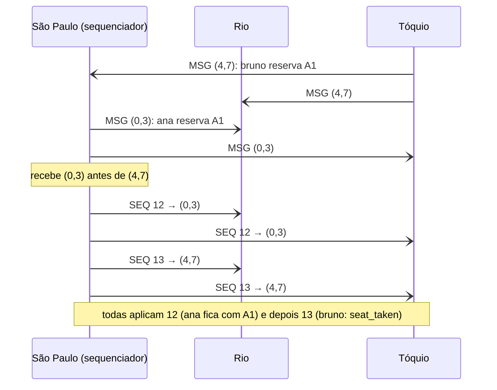
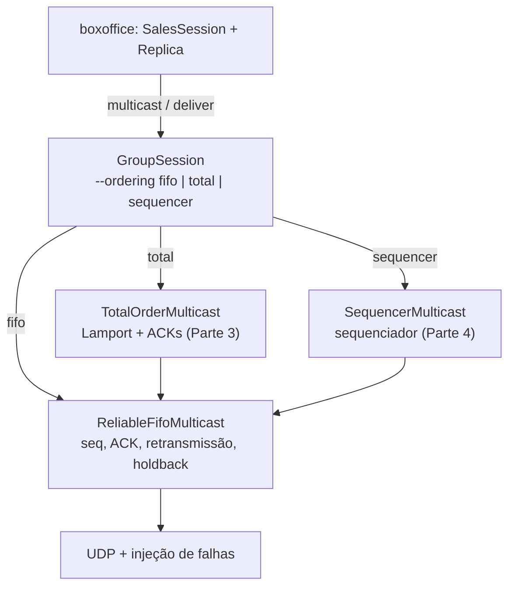
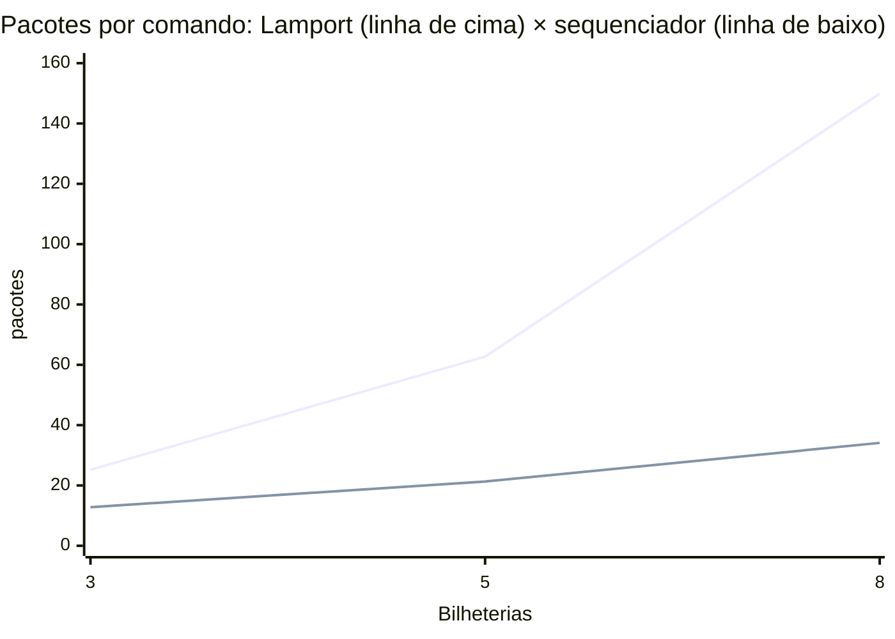

# Bilheterias replicadas com sequenciador: consistência com menos mensagens

[](https://github.com/fernandes-emmanuel/trabalho-final-sd-pt-4/actions/workflows/ci.yml)

Parte 4 do trabalho final de Sistemas Distribuídos. Na
[Parte 3](https://github.com/fernandes-emmanuel/trabalho-final-sd-pt-3), as bilheterias
replicadas ficaram consistentes graças ao multicast totalmente ordenado com relógios de Lamport.
O preço foi alto: cada comando gera ACKs de **todas** as réplicas para **todas** as réplicas
(O(N²) pacotes), e a latência fica presa à réplica mais lenta.

Esta parte projeta e implementa um **mecanismo de coordenação mais leve**, com menos trocas de
mensagens, que mantém a mesma garantia de consistência: a **replicação ativa com sequenciador**,
um protocolo baseado em primário (Tanenbaum & van Steen, Cap. 7).

## Integrantes – Grupo K

- Emmanuel Fernandes Castro
- Monik Alves da Costa
- Luis Cesar Ferreira do Carmo

## Sumário

1. [Ponto de partida](#ponto-de-partida)
2. [O mecanismo: sequenciador](#o-mecanismo-sequenciador)
3. [Por que é mais leve](#por-que-é-mais-leve)
4. [Arquitetura](#arquitetura)
5. [Detalhes de implementação](#detalhes-de-implementação)
6. [Garantia de consistência](#garantia-de-consistência)
7. [Evidências experimentais](#evidências-experimentais)
8. [Comparação dos mecanismos](#comparação-dos-mecanismos)
9. [Como executar](#como-executar)
10. [Testes](#testes)
11. [Estrutura do repositório](#estrutura-do-repositório)
12. [Limitações](#limitações)

## Ponto de partida

A aplicação é a mesma das partes anteriores. Bilheterias de várias cidades vendem ingressos de um
mesmo evento, cada uma com uma réplica completa do mapa de assentos. Os comandos (`reserve`,
`reserve_group`, `cancel`) não comutam: se as réplicas os aplicarem em ordens diferentes, o mesmo
assento é vendido a clientes diferentes. A consistência exige que **todas as réplicas apliquem os
mesmos comandos na mesma ordem**.

| Parte | Mecanismo | Consistente? | Pacotes por comando (5 bilheterias) |
|---|---|---|---:|
| 2 | Multicast confiável FIFO | Não (overbooking) | ~10 |
| 3 | Ordem total com relógios de Lamport + ACKs | Sim | ~62 |
| **4** | **Ordem total com sequenciador** | **Sim** | **~21** |

## O mecanismo: sequenciador

No Cap. 7, ao discutir a **replicação ativa**, o livro observa que ela exige multicast totalmente
ordenado, e que esse multicast pode ser implementado com um coordenador central, o **sequenciador**,
que atribui a cada operação um número de sequência único. Em vez de os membros chegarem juntos a
uma ordem, trocando ACKs entre todos como na Parte 3, **um único membro decide a ordem**, e os demais
apenas a seguem. É a mesma ideia dos protocolos baseados em primário: um ponto do sistema serializa
as atualizações.

**Algoritmo**, com uma bilheteria designada como sequenciador:

1. Para enviar um comando, a bilheteria `p` o envia por multicast ao grupo **uma única vez**, com um
   identificador local `(p, k)`.
2. O sequenciador, ao receber `(p, k)`, atribui o próximo **número de sequência global** `s` e envia
   ao grupo `SEQ s → (p, k)`, uma mensagem pequena, sem o comando.
3. Cada bilheteria entrega os comandos **na ordem dos números de sequência**: o comando número `s`
   é aplicado quando ela já tem o comando e a atribuição, e os números `0..s−1` já foram aplicados.



A ordem global é a ordem em que o sequenciador recebeu os comandos. Ela pode ser qualquer uma, mas
é **a mesma para todas as réplicas**, e é isso que a consistência exige.

## Por que é mais leve

Para N bilheterias, contando os pacotes de dados e os ACKs de transporte do multicast confiável
(cada pacote de dados recebe um ACK):

| Mecanismo | Multicasts por comando | Pacotes por comando | N = 3 | N = 5 | N = 8 |
|---|---|---|---:|---:|---:|
| FIFO (Parte 2, inconsistente) | 1 | 2N | 6 | 10 | 16 |
| Lamport + ACKs (Parte 3) | 1 + N | 2N(N+1) | 24 | 60 | 144 |
| **Sequenciador (Parte 4)** | **2** | **4N** | **12** | **20** | **32** |

- **Mensagens de controle por comando:** N com Lamport (um ACK de cada membro) contra **1** com o
  sequenciador (uma atribuição). O custo deixa de crescer com **O(N²)** e passa a crescer com
  **O(N)**.
- **Latência:** com Lamport, um comando só é aplicado depois do ACK de **todos** os membros, então
  a latência acompanha o membro mais lento. Com o sequenciador, um comando de `p` chega a uma réplica
  `r` em `p → sequenciador → r`; nenhuma outra réplica participa. Para o próprio sequenciador e para
  as réplicas próximas dele, a latência cai drasticamente.
- **A atribuição não carrega o comando.** Ela tem só o par `(p, k)`, então o comando viaja pela rede
  uma única vez.

## Arquitetura

A camada de ordenação foi generalizada atrás de uma interface comum (`OrderedMulticast`). A
`GroupSession` escolhe o mecanismo, e **a aplicação não mudou**: o domínio continua só com
`multicast` e `deliver`.



| Módulo | Responsabilidade |
|---|---|
| `mpcomm/ordering/base.py` | `Ordering` (`fifo`, `total`, `sequencer`), interface `OrderedMulticast`, contadores |
| `mpcomm/ordering/sequencer.py` | **Sequenciador**: identificadores locais, atribuição de números globais, entrega em ordem |
| `mpcomm/ordering/total_order.py` | Lamport + ACKs (Parte 3), mantido para comparação |
| `mpcomm/group/session.py` | Cria a camada de ordenação escolhida e coordena abertura e fechamento |
| `boxoffice/office/node.py` | Resolve o sequenciador pelo **nome** da bilheteria (`--sequencer sao-paulo`) |

## Detalhes de implementação

### Mensagens

Viajam dentro das mensagens `DATA` do multicast confiável FIFO:

```json
{"order": "msg", "id": 3, "body": {"id": "0.4", "op": "reserve", "seats": ["A1"], "customer": "ana"}}
{"order": "seq", "seq": 12, "ref": [0, 3]}
{"order": "end", "id": 41}
```

### Estruturas de dados

Em [`SequencerMulticast`](mpcomm/ordering/sequencer.py):

| Estrutura | Uso |
|---|---|
| `_next_local` | Próximo identificador local dos comandos desta bilheteria |
| `_next_global` | (só no sequenciador) próximo número de sequência a atribuir |
| `_received: dict[(remetente, id), comando]` | Comandos recebidos e ainda não aplicados |
| `_assigned: dict[número, (remetente, id)]` | Atribuições recebidas do sequenciador |
| `_next_delivery` | Próximo número a aplicar. Lacunas bloqueiam os números seguintes |

Os comandos e as atribuições podem chegar em qualquer ordem relativa, porque vêm de remetentes
diferentes. Por isso a entrega exige **as duas coisas**.

### Escolha do sequenciador

O auditor indica o sequenciador pelo nome (`--sequencer sao-paulo`), e cada bilheteria o resolve a
partir da lista de membros obtida do group manager na abertura da sessão. Sem a opção, o sequenciador
é a bilheteria de menor id, uma escolha determinística que não exige troca de mensagens. Um
sequenciador inexistente é recusado com `FAILED_PRECONDITION`. A escolha aparece no relatório:
`sequencer order (sequencer: sao-paulo)`.

### Fechamento da sessão

O fechamento é o mesmo protocolo de duas fases da Parte 3, que agora funciona para qualquer camada
de ordenação. Cada bilheteria envia um `end` **ordenado pelo sequenciador**. Como os comandos dela
chegam ao sequenciador antes do `end` (canal FIFO), recebem números menores. Quando os `end` de
todos foram entregues, todos os comandos também foram. O sequenciador continua atribuindo números
até esse ponto, inclusive depois do próprio `end`.

### Concorrência

A disciplina da Parte 3 vale aqui também: locks na ordem emissão → ordenação → envio → transporte,
e a thread de recepção repassa as mensagens à camada de cima sem segurar locks. O sequenciador envia
as atribuições de dentro da thread de recepção, ainda no lock da ordenação e antes do lock de envio,
então nenhum ciclo é possível.

## Garantia de consistência

**Teorema.** Com canais confiáveis e FIFO, membros que não falham e grupo fixo durante a sessão,
todas as bilheterias aplicam os mesmos comandos na mesma ordem.

**Argumento:**

1. **A ordem é única.** Só o sequenciador atribui números. Ele os atribui de forma consecutiva
   (`0, 1, 2, …`) e uma única vez para cada comando. Atribuições de qualquer outro membro são
   ignoradas.
2. **Todos recebem tudo.** O canal confiável garante que todo comando e toda atribuição chegam a
   todos os membros.
3. **Todos aplicam pela mesma regra.** Cada réplica aplica exatamente na ordem `0, 1, 2, …`,
   esperando enquanto houver lacuna. A sequência aplicada é, portanto, idêntica em todas as réplicas.
4. **A ordem de cada remetente é preservada.** Os comandos de `p` chegam ao sequenciador pelo canal
   FIFO `p → sequenciador`, na ordem em que `p` os emitiu, e recebem números crescentes.

Como o mapa de assentos é uma máquina de estados determinística, as réplicas passam pelos mesmos
estados e produzem os mesmos resultados. Nenhum assento é vendido a dois clientes, e cada cliente
recebe a resposta que qualquer outra bilheteria daria. O modelo de consistência é o mesmo da
Parte 3: **sequencial**, com leituras locais (`map`) possivelmente defasadas.

### Troca de premissas em relação à Parte 3

| Aspecto | Lamport + ACKs (Parte 3) | Sequenciador (Parte 4) |
|---|---|---|
| Quem decide a ordem | Todos, de forma distribuída | Um único membro |
| De quem cada comando depende | De **todos** os membros (ACKs) | Do **sequenciador** |
| Falha de um membro comum | Bloqueia toda a fila | Os comandos dos demais continuam sendo ordenados e aplicados; só o fechamento depende do `end` de todos |
| Falha do sequenciador | — | **Bloqueia** a ordenação (ponto único de falha) |
| Carga | Distribuída | Concentrada no sequenciador (possível gargalo) |

Em nenhum dos casos uma falha causa **inconsistência**: o sistema para, mas não diverge. Tolerar a
queda do sequenciador exigiria eleger um novo e recuperar as atribuições pendentes, algo que este
trabalho não implementa (ver [Limitações](#limitações)).

## Evidências experimentais

### FIFO × Lamport × sequenciador

O script [`benchmarks/consistency_experiment.py`](benchmarks/consistency_experiment.py) executou
**150 sessões**: 5 cenários de rede × 3 mecanismos × 10 sessões. Cada sessão teve 5 bilheterias e
40 comandos por bilheteria (200 por sessão), com carga concentrada em 4 assentos disputados. O
atraso, o jitter e a perda foram injetados na aplicação, com *seed* fixa, em processos separados.

| Rede | Mecanismo | Sessões consistentes | Overbooking (assentos/sessão) | Latência média (ms) | Latência p95 (ms) | Pacotes por comando |
|---|---|---:|---:|---:|---:|---:|
| 0 ± 0 ms | FIFO | 9/10 | 0,1 | 0,3 | 0,6 | 10,5 |
| 0 ± 0 ms | Lamport | 10/10 | 0,0 | 0,9 | 1,6 | 62,0 |
| 0 ± 0 ms | **sequenciador** | **10/10** | 0,0 | 0,5 | 0,9 | **21,0** |
| 5 ± 5 ms | FIFO | 0/10 | 3,6 | 10,3 | 22,2 | 10,5 |
| 5 ± 5 ms | Lamport | 10/10 | 0,0 | 29,5 | 41,6 | 62,0 |
| 5 ± 5 ms | **sequenciador** | **10/10** | 0,0 | 23,2 | 37,8 | **21,0** |
| 20 ± 20 ms | FIFO | 0/10 | 6,2 | 29,4 | 65,9 | 10,6 |
| 20 ± 20 ms | Lamport | 10/10 | 0,0 | 112,9 | 143,4 | 62,8 |
| 20 ± 20 ms | **sequenciador** | **10/10** | 0,0 | 76,6 | 122,5 | **21,3** |
| 60 ± 60 ms | FIFO | 0/10 | 11,1 | 104,2 | 207,2 | 10,9 |
| 60 ± 60 ms | Lamport | 10/10 | 0,0 | 368,3 | 446,8 | 64,3 |
| 60 ± 60 ms | **sequenciador** | **10/10** | 0,0 | 258,2 | 369,4 | **21,9** |
| 20 ± 20 ms, 10% de perda | FIFO | 0/10 | 13,6 | 110,7 | 564,3 | 12,4 |
| 20 ± 20 ms, 10% de perda | Lamport | 10/10 | 0,0 | 1416,8 | 2286,0 | 74,2 |
| 20 ± 20 ms, 10% de perda | **sequenciador** | **10/10** | 0,0 | **424,8** | 1145,7 | **25,0** |

- **Sequenciador: 50 de 50 sessões consistentes**, a mesma garantia do Lamport: nenhum overbooking
  e logs idênticos em todas as réplicas.
- **~2,9× menos pacotes por comando** que o Lamport (21 contra 62), apenas o dobro do FIFO, que é
  inconsistente.
- **Latência menor em todos os cenários com atraso** (de 21% a 32% menor). Com 10% de perda, a
  diferença chega a **3,3×**: no Lamport, qualquer ACK perdido de qualquer membro atrasa todos os
  comandos; no sequenciador, só as mensagens no caminho remetente → sequenciador → réplica importam.

### Escalabilidade com o número de bilheterias

[`benchmarks/scalability_experiment.py`](benchmarks/scalability_experiment.py): 5 sessões por
configuração, 30 comandos por bilheteria, rede de 5 ms ± 5 ms.

| Bilheterias | Mecanismo | Consistentes | Pacotes previstos | Pacotes medidos | Latência média (ms) |
|---:|---|---:|---:|---:|---:|
| 3 | Lamport | 5/5 | 24 | 25,2 | 30,1 |
| 3 | **sequenciador** | 5/5 | 12 | 12,8 | 23,8 |
| 5 | Lamport | 5/5 | 60 | 62,7 | 29,9 |
| 5 | **sequenciador** | 5/5 | 20 | 21,3 | 23,5 |
| 8 | Lamport | 5/5 | 144 | 149,9 | 28,2 |
| 8 | **sequenciador** | 5/5 | 32 | 34,1 | 22,0 |



As medições batem com as fórmulas (2N(N+1) contra 4N), com uma pequena sobra de mensagens de controle
da sessão e retransmissões. Com 8 bilheterias, o sequenciador já usa **4,4× menos pacotes**, e a
diferença continua crescendo com N.

### Cenário geográfico com Docker: o lugar do sequenciador importa

Cinco bilheterias: São Paulo, Rio e Belo Horizonte a 2 ms entre si, e Lisboa e Tóquio com
120 ms ± 60 ms e 5% de perda (`tc netem`). Foram 3 sessões de 30 comandos por bilheteria em cada
configuração, todas **consistentes (3/3)**.

| Configuração | Latência média | São Paulo | Rio | Belo Horizonte | Lisboa | Tóquio | Pacotes por comando |
|---|---:|---:|---:|---:|---:|---:|---:|
| Lamport + ACKs | 1035 ms | 781 | 1037 | 893 | 1342 | 1123 | 78,4 |
| **Sequenciador em São Paulo** | **177 ms** | **0** | **50** | **138** | 341 | 356 | **28,5** |
| Sequenciador em Tóquio | 362 ms | 371 | 445 | 389 | 605 | 0 | 25,6 |

- Com o sequenciador em São Paulo, a latência média cai **5,8×** em relação ao Lamport, e **as
  bilheterias da região do sequenciador respondem quase instantaneamente**.
- O sequenciador em Tóquio ainda é melhor que o Lamport, mas obriga as três bilheterias brasileiras a
  esperar a viagem de ida e volta até Tóquio. A recomendação prática é colocar o sequenciador onde
  está a maior parte da demanda, que é a escolha padrão do `docker-compose.yml`.
- Os pacotes por comando ficam acima do previsto (28,5 contra 20) por causa das retransmissões nos
  enlaces com perda da região B.

Corrida pelo A1 entre São Paulo e Tóquio, com o sequenciador em São Paulo:

```text
$ docker compose run --rm client race A1 --offices office-sao-paulo:5679 office-toquio:5679 --customers ana bruno
Simultaneous requests for seat A1:
  ana        at sao-paulo      -> accepted
  bruno      at toquio         -> seat_taken

Owner of A1 according to each office:
  sao-paulo      -> ana
  toquio         -> ana
```

## Comparação dos mecanismos

| Critério | FIFO (Parte 2) | Lamport + ACKs (Parte 3) | **Sequenciador (Parte 4)** |
|---|---|---|---|
| Consistência das réplicas | ❌ 9 de 50 sessões | ✅ 50 de 50 | ✅ **50 de 50** |
| Pacotes por comando (N = 5) | 10 | 62 | **21** |
| Crescimento com N | O(N) | O(N²) | **O(N)** |
| Latência depende de | — | do membro mais lento | do caminho até o sequenciador |
| Ponto único de falha | não | não (mas qualquer falha bloqueia) | **sim (o sequenciador)** |
| Carga | distribuída | distribuída | concentrada no sequenciador |

O sequenciador atinge o objetivo da Parte 4: **a mesma garantia de consistência da ordem total, com
cerca de um terço das mensagens e latência menor**. Em troca, concentra a responsabilidade num único
processo.

## Como executar

### Pré-requisitos

- Python 3.11 ou superior
- Docker com Compose, para o cenário geográfico

```bash
python -m venv .venv
source .venv/bin/activate        # Windows: .venv\Scripts\activate
pip install -e ".[dev]"
```

### Localhost

```bash
boxoffice local --offices 5 --sessions 3 --commands 40 --delay-ms 20 --jitter-ms 20                        # sequenciador
boxoffice local --offices 5 --sessions 3 --commands 40 --delay-ms 20 --jitter-ms 20 --sequencer recife     # outro sequenciador
boxoffice local --offices 5 --sessions 3 --commands 40 --delay-ms 20 --jitter-ms 20 --ordering total       # Lamport (Parte 3)
python benchmarks/consistency_experiment.py --sessions 10       # tabela FIFO × Lamport × sequenciador (~7 min)
python benchmarks/scalability_experiment.py                     # tabela de escalabilidade (~3 min)
```

A ordenação padrão é `sequencer`, e o sequenciador padrão é a bilheteria de menor id.

### Terminais separados

```bash
boxoffice group-manager
boxoffice office --name sao-paulo --advertise-host 127.0.0.1 --udp-port 6789 --control-port 5679
boxoffice office --name rio --advertise-host 127.0.0.1 --udp-port 6790 --control-port 5690
boxoffice auditor --advertise-host 127.0.0.1 --offices 2 --sequencer sao-paulo

boxoffice client --office 127.0.0.1:5690 reserve A1 --customer ana
boxoffice client race C5 --offices 127.0.0.1:5679 127.0.0.1:5690 --customers carla diego
```

### Docker: bilheterias em dois continentes

```bash
docker compose up -d --build
docker compose run --rm auditor                       # interativo, sequenciador em São Paulo
```

Em outro terminal, com a venda aberta:

```bash
docker compose run --rm client race A1 --offices office-sao-paulo:5679 office-toquio:5679 --customers ana bruno
docker compose run --rm client --office office-toquio:5679 map
```

Comparação automática entre os mecanismos e as posições do sequenciador:

```bash
docker compose run --rm auditor boxoffice auditor --offices 5 --ordering total --sessions 3 --commands 30 --keep-group
docker compose run --rm auditor boxoffice auditor --offices 5 --sequencer sao-paulo --sessions 3 --commands 30 --keep-group
docker compose run --rm auditor boxoffice auditor --offices 5 --sequencer toquio --sessions 3 --commands 30
docker compose down
```

## Testes

```bash
pytest -v                  # 148 testes
pytest -m "not integration"
ruff check . && ruff format --check .
```

| Arquivo | O que verifica |
|---|---|
| `tests/test_sequencer.py` | **Propriedade de ordem total** em 25 *seeds* com 20% de perda, duplicação e reordenação, com o sequenciador em membros diferentes; **exatamente 1 mensagem de controle por comando, contra N do Lamport**, para N = 3, 5 e 8; numeração na ordem de chegada; entrega só com comando e número; lacunas bloqueiam; números de quem não é o sequenciador são ignorados; `end` ordenado |
| `tests/test_total_order.py` | Lamport + ACKs (Parte 3) e a contraprova de que FIFO não basta |
| `tests/ordering_harness.py` | Arranjo comum que monta qualquer mecanismo sobre a rede simulada determinística |
| `tests/test_group_session.py` | `GroupSession` sobre UDP real com 20% de perda nos três modos; no modo sequenciador, só o sequenciador envia controle |
| `tests/test_offices.py` | Bilheterias reais com uma delas distante: pedidos simultâneos têm um único vencedor e as réplicas são idênticas, com Lamport e com o sequenciador na bilheteria distante; sequenciador desconhecido é recusado |
| `tests/test_integration.py` | Implantação completa com perda e atraso: o sequenciador é consistente e usa menos da metade dos pacotes do Lamport |
| `tests/test_audit.py`, `tests/test_domain.py` e outros | Auditoria, domínio, multicast confiável, injetor de falhas e membership |

A CI ([`.github/workflows/ci.yml`](.github/workflows/ci.yml)) executa o lint e os testes no Ubuntu
e no Windows, com Python 3.12 e 3.14, e sobe as cinco bilheterias com Docker Compose.

## Estrutura do repositório

```text
├── protos/                          contratos gRPC (membership e bilheterias)
├── mpcomm/                          middleware de comunicação em grupo
│   ├── ordering/
│   │   ├── base.py                  interface comum e modos de ordenação
│   │   ├── sequencer.py             ordem total por sequenciador (Parte 4)
│   │   └── total_order.py           ordem total com Lamport (Parte 3)
│   ├── group/session.py             sessão de grupo com ordenação configurável
│   ├── transport/                   UDP, mensagens, falhas, multicast confiável FIFO
│   ├── membership/                  group manager
│   └── rpc/                         stubs, clientes e servidor gRPC
├── boxoffice/                       aplicação de venda de ingressos
├── benchmarks/
│   ├── consistency_experiment.py    FIFO × Lamport × sequenciador
│   └── scalability_experiment.py    custo em função do número de bilheterias
├── tests/
├── Dockerfile, docker-compose.yml, docker/entrypoint.sh
└── .github/workflows/ci.yml
```

## Limitações

- **O sequenciador é um ponto único de falha e um possível gargalo.** Se ele cair, a ordenação para
  (sem inconsistência). Tolerar essa falha exigiria detectá-la, eleger um novo sequenciador (Cap. 5)
  e fazer o novo líder recuperar das réplicas as atribuições já feitas.
- O sequenciador é fixo durante a sessão. Escolhê-lo dinamicamente, por exemplo pela região com mais
  demanda, ficou fora do escopo.
- As leituras locais (`map`) podem estar defasadas em relação a comandos ainda não ordenados.
- O group manager continua sendo um ponto único de falha, e os canais gRPC não são cifrados.
